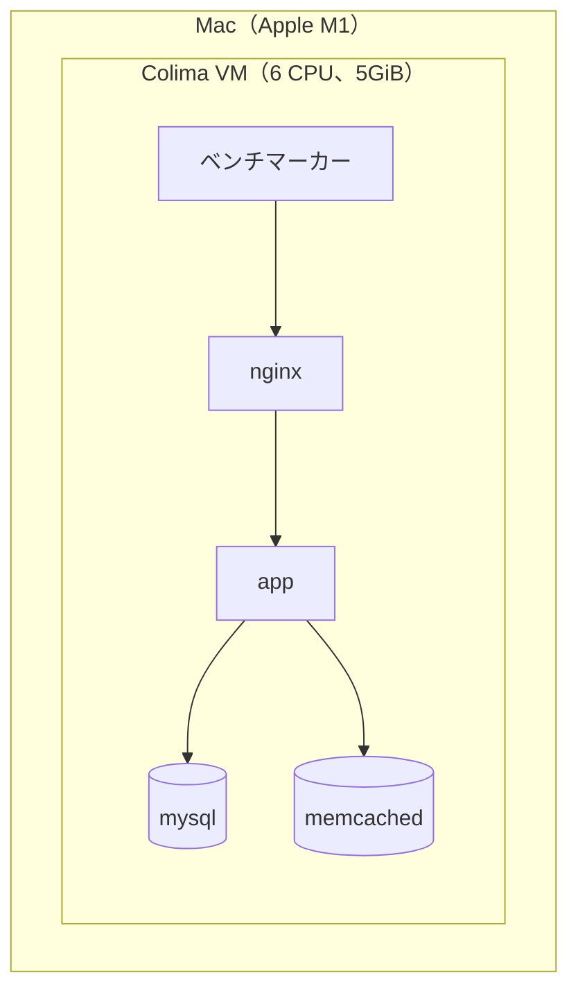
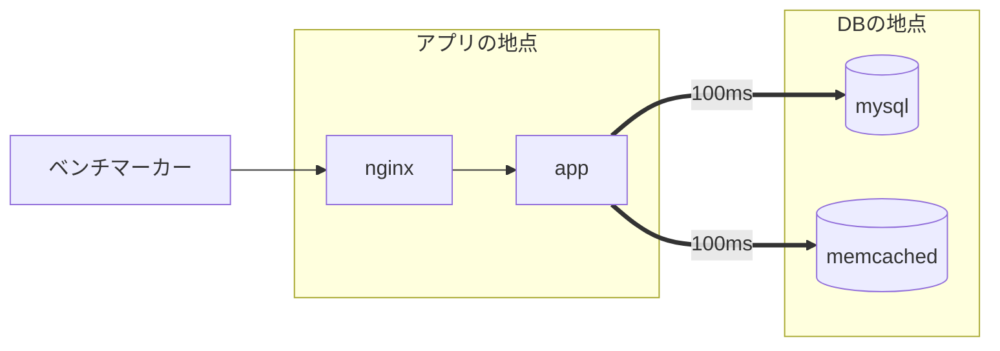
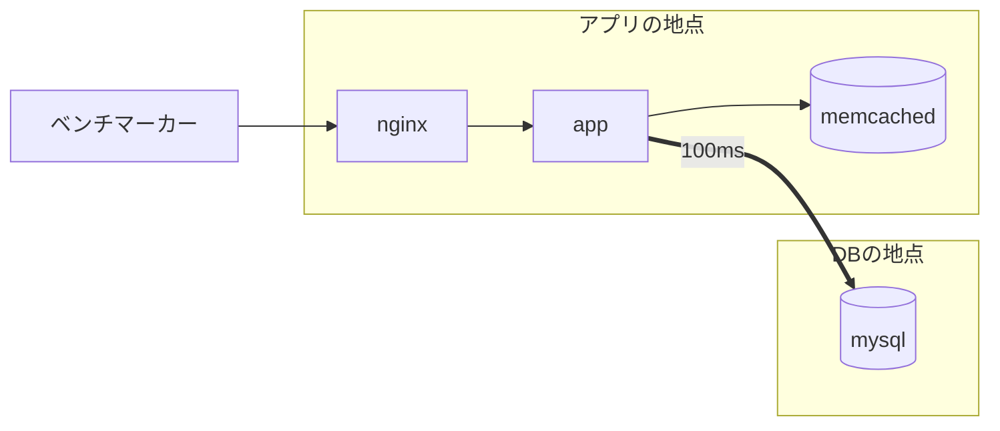
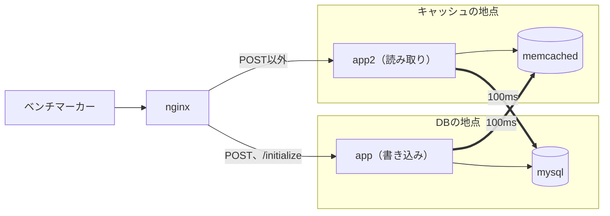
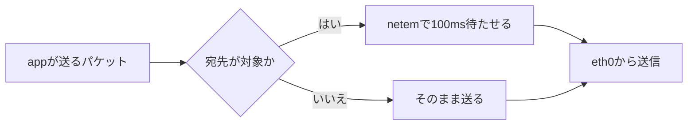

# 遅延で再現する構成

遠隔構成を、1台のMacの上でどう再現しているかをまとめる。

全コンテナは同じMacのColima VMで動いている。サーバーを実際に離して置くのではなく、通信に遅延を入れて、離れた場所にあるように見せている。

## 実際の配置



`app2` は `perf-07` からの追加である。コンテナどうしの通信は、遅延を入れなければほぼ0msで届く。

## 物理配置と設定の対応

| 再現したいこと | 設定 | 場所 |
| --- | --- | --- |
| サーバーどうしの距離 | 送信パケットを `tc netem` で遅らせる | `scripts/practice.sh` の `delay_on` |
| 距離の大きさ | 遅延のミリ秒。100は本番のeurope1、america1からDBまでのRTT（約100ms）に合わせた値 | `measure` の引数 |
| どのサーバーどうしが遠いか | 送信元と宛先の組み合わせ | `webapp/latency-targets` |
| サーバーの性能 | コンテナのCPUとメモリの上限 | `webapp/compose.kokeshi.yml` |
| 振り分け | nginxの `upstream` と `map` | `webapp/etc/nginx/conf.d/default.conf` |

`webapp/latency-targets` は、1行が `<送信元> <宛先>...` の形式である。

```text
app memcached
app2 mysql
```

ファイルがない段階では、`app mysql memcached` として扱う。

## 模擬している構成

図の枠は地点を表す。枠をまたぐ太い矢印の通信に、遅延が入る。

### perf-01からperf-05: アプリだけが遠い



| 設定 | 値 |
| --- | --- |
| `latency-targets` | なし（既定の `app mysql memcached`） |

### perf-06: memcachedをアプリの隣へ移す



| 設定 | 値 |
| --- | --- |
| `latency-targets` | `app mysql` |

コンテナは動かしていない。`app` からmemcachedへの遅延をなくすことで、隣に移したことにしている。

### perf-07: 近いアプリと遠いアプリの2台



| 設定 | 値 |
| --- | --- |
| `latency-targets` | `app memcached` と `app2 mysql` |

## 遅延を入れる仕組み

`delay_on` は、遅延の対象の送信元ごとに次を設定する。



1. `colima ssh` でVMに入る。
2. `nsenter` で、対象のコンテナのネットワークに入る。
3. `eth0` に `prio` のキューと、`netem delay` の出口を作る。
4. `tc filter` で、宛先IPが対象のパケットだけを `netem` の出口へ流す。

遅延を入れるのは行きのパケットだけで、返りには入らない。それでも1往復は指定した値だけ長くなるので、100msの設定はRTTが100ms増えることを表す。

遅延なしの計測では、`delay off` でこの設定を削除する。同じコードを0msと100msで計測し、差を距離の影響として見る。

## 再現していないこと

| 項目 | 実際の遠隔構成 | この環境 |
| --- | --- | --- |
| 帯域 | 回線ごとに上限がある | 制限なし |
| パケットロス | 起こることがある | なし |
| 遅延の揺らぎ | 時間で変わる | 常に同じ値 |
| CPU | サーバーごとに独立している | 同じMacのCPUを、ベンチマーカーも含めて分け合う |
| `perf-07` の画像ファイル | 地点が別なら共有できない | 2台で同じボリュームを共有 |
| `perf-07` のnginx | `app` と `app2` の少なくとも一方とは距離ができる | どちらへも遅延なし |

そのため、スコアの値は実際の遠隔構成とは一致しない。同じ条件の中で、変更による差を比べるために使う。
