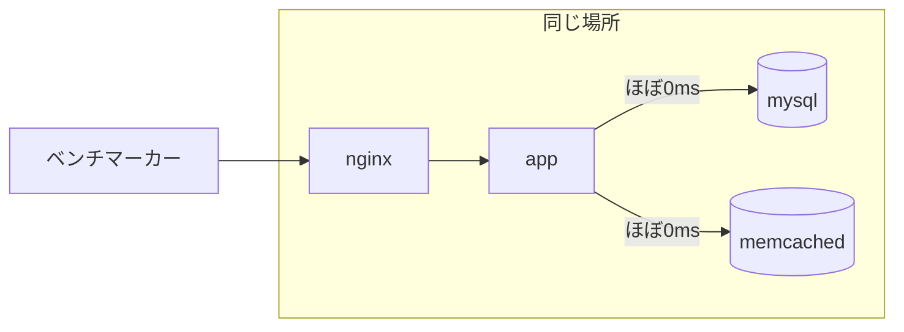
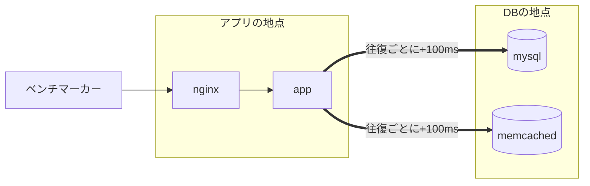
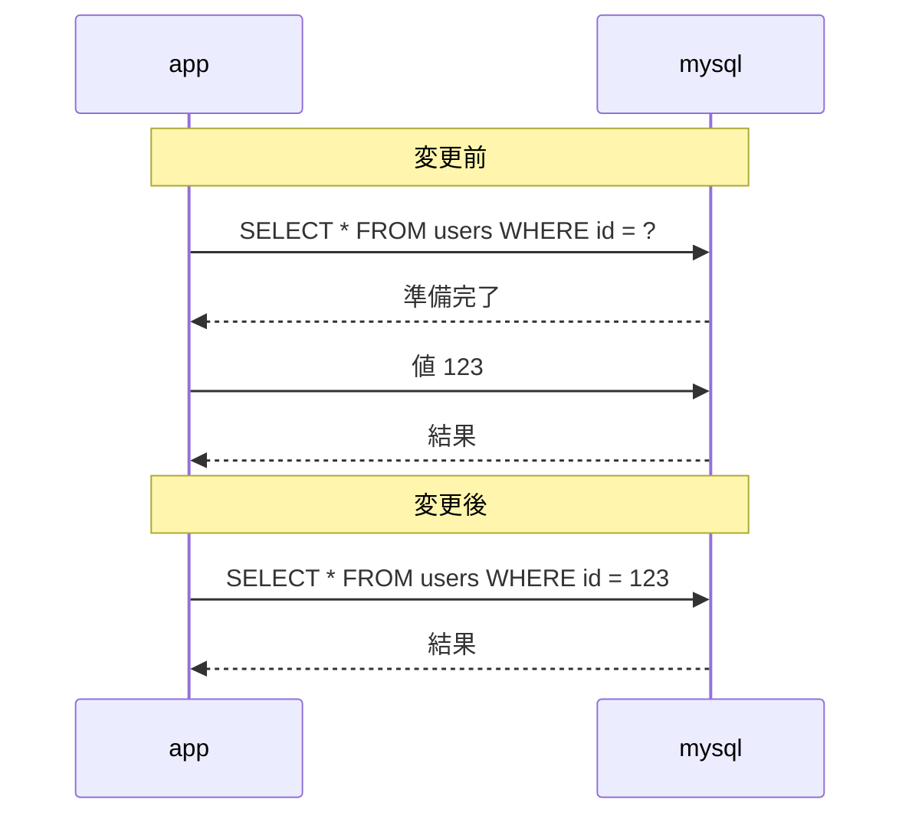
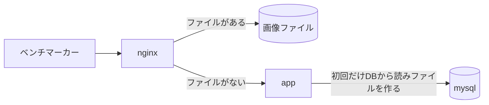
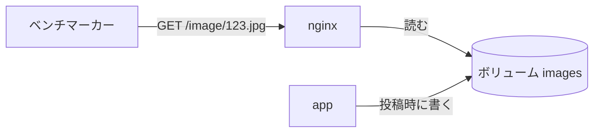
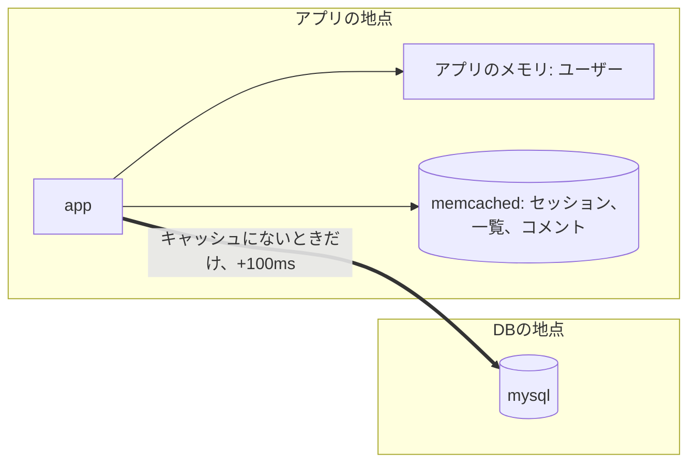
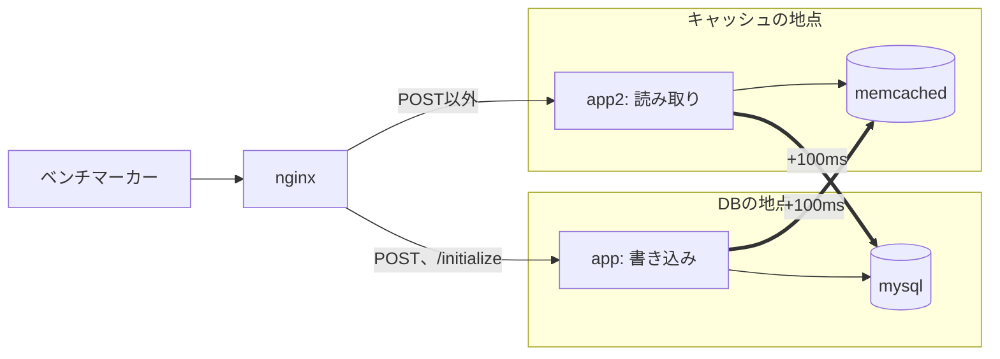

# 性能改善レポート

全段階を、同じ条件で一括計測した確定値である。

| 項目 | 条件 |
| --- | --- |
| 計測日時 | 2026-11-02 22:30ごろから2026-11-03 00:07 |
| 電源 | AC電源、低電力モードなし |
| 環境 | Colima 6 CPU、5GiB |
| 回数 | 遅延なし、100msの各3回。値は中央値 |
| 計測ごとの準備 | DBと画像を基準データへ復元 |
| 実行 | `scripts/measure-all.sh 3` |
| 記録 | `results/summary.tsv` の `final-` で始まる行 |

全14条件の計42回で、`final-01` と `final-02` の100ms以外は失敗数が0である。この2条件は、各回とも失敗6件で0点になった。

## 結果

変更は積み重ねなので、各行はそれより上の変更をすべて含む。

| No | 変更 | コミット | 遅延なし | 前段比 | 基準比 | 100ms | 前段比 |
| --- | --- | --- | --- | --- | --- | --- | --- |
| 01 | 何もしない | `3f0eb60` | 3,476 | - | 1.0倍 | 0 | - |
| 02 | `db-index` | `3f0eb60` | 38,459 | 11.1倍 | 11.1倍 | 0 | - |
| 03 | `db-query` | `902e253` | 62,208 | 1.6倍 | 17.9倍 | 2,261 | 0点から完走 |
| 04 | `app-connection` | `9817c01` | 76,485 | 1.2倍 | 22.0倍 | 5,951 | 2.6倍 |
| 05 | `static` | `18dbd50` | 296,071 | 3.9倍 | 85.2倍 | 23,711 | 4.0倍 |
| 06 | `cache` | `24f452e` | 336,503 | 1.1倍 | 96.8倍 | 350,493 | 14.8倍 |
| 07 | `infra` | `f2c6dce` | 286,194 | 0.85倍 | 82.3倍 | 447,934 | 1.3倍 |

各回の値は次のとおりである。

| No | 遅延なし | 100ms |
| --- | --- | --- |
| 01 | 3,461 / 3,509 / 3,476 | 0 / 0 / 0 |
| 02 | 33,206 / 38,459 / 39,334 | 0 / 0 / 0 |
| 03 | 62,625 / 59,359 / 62,208 | 2,261 / 2,094 / 2,289 |
| 04 | 76,485 / 82,738 / 76,271 | 6,145 / 5,924 / 5,951 |
| 05 | 251,275 / 296,071 / 299,576 | 23,643 / 23,720 / 23,711 |
| 06 | 336,503 / 329,914 / 346,972 | 337,047 / 350,493 / 372,401 |
| 07 | 286,194 / 310,828 / 270,868 | 421,993 / 487,062 / 447,934 |

## 分かったこと

- **遅延なし:** 最も効いたのは `db-index`（11.1倍）と `static`（3.9倍）である。
- **100ms:** `db-index` だけでは0点のままだった。往復回数を減らす `db-query` で完走できるようになり、DBへ行かなくする `cache` が最も効いた（14.8倍）。
- **`infra`:** 100msでは1.3倍に伸びたが、遅延なしでは0.85倍に下がった。各回の値の範囲も重ならない。遠隔構成向けの変更なので、遅延がない環境では得をしない。下がった原因は確認していない。

## 変更の内容

| No | 内容 | 遠隔構成への効果 |
| --- | --- | --- |
| 02 | `comments` と `posts` にインデックス4本 | DB内の処理は速くなるが、往復回数は減らない |
| 03 | N+1の解消、`LIMIT` の追加、JOINの利用 | トップページの往復が約264回から数回になり、100msで完走できるようになった |
| 04 | `interpolateParams`、接続プール | 1クエリの2往復を1往復にし、接続のたびの往復をなくす |
| 05 | 画像をファイルにしてnginxから配信 | 画像の取得でDBへの往復がなくなる |
| 06 | ユーザー、一覧、コメントのキャッシュ。memcachedをアプリの隣へ移動 | 読み取りの大半がDBへ行かなくなる |
| 07 | 近いアプリと遠いアプリの2台。書き込みは近い方、読み取りは遠い方へ振り分け | 書き込みの往復を短くする |

構成の図は [arch-01-latency-topology.md](arch-01-latency-topology.md) にある。

## 遠隔設定とは

遠隔設定は、アプリとDBが離れた場所にある状態を、通信の遅延で再現する設定である。全コンテナは同じMacの中にあり、実際には移動していない。

### 遠隔設定なし（遅延なし）

全サーバーが同じ場所にある。DBとの往復は、ほぼ0msで終わる。



### 遠隔設定あり（100ms、01から05の場合）

アプリとDBが離れた場所にある。往復1回につき、100ms増える。



06と07の遠隔設定は配置が異なる。

| 段階 | 遅延が入る通信 |
| --- | --- |
| 01から05 | `app` → mysql、`app` → memcached |
| 06 | `app` → mysql |
| 07 | `app` → memcached、`app2` → mysql |

設定の詳細は [arch-01-latency-topology.md](arch-01-latency-topology.md) にある。

### 遠隔設定の有無による効果の差

| No | 変更 | 遅延なし 直前比 | 100ms 直前比 | 100msの値は遅延なしの何% |
| --- | --- | --- | --- | --- |
| 01 | 何もしない | - | - | 0% |
| 02 | `db-index` | 11.1倍 | 0点のまま | 0% |
| 03 | `db-query` | 1.6倍 | 0点から完走 | 3.6% |
| 04 | `app-connection` | 1.2倍 | 2.6倍 | 7.8% |
| 05 | `static` | 3.9倍 | 4.0倍 | 8.0% |
| 06 | `cache` | 1.1倍 | 14.8倍 | 104% |
| 07 | `infra` | 0.85倍 | 1.3倍 | 157% |

| 変更の種類 | 該当 | 遅延なし | 100ms |
| --- | --- | --- | --- |
| DBの中の処理を速くする | 02 | 大きく効く | 点が付かない |
| DBとの往復を減らす | 03、04、06 | 少し効く | 大きく効く |
| アプリとDBを通らなくする | 05 | 大きく効く | 大きく効く |
| サーバーの配置を変える | 07 | 下がった | 少し効く |

06と07の100msは、遅延なしを上回った原因を確認していない。この2行の比率は参考値として扱う（[未確認の点](#未確認の点)）。

## Detail

### 01 何もしない

改善していない状態である。トップページの表示で、投稿20件のそれぞれについて、コメント数、コメント、コメントを書いたユーザー、投稿者を別々のクエリで取得する（N+1）。

| 項目 | 値 |
| --- | --- |
| トップページ1回の表示でDBへ送るSQL | 132回（実測） |
| DBとの往復 | 264回（SQL1回につき、準備と実行で2往復） |

SQLの内訳は次のとおりである。コメントの数で変わり、内訳から数えた最大は約122回になる。実測の132回との差は確認していない。

| SQL | 回数 |
| --- | --- |
| 投稿の一覧 | 1回 |
| 投稿ごとのコメント数 | 20回 |
| 投稿ごとのコメント（最大3件） | 20回 |
| コメントを書いたユーザー | 最大60回 |
| 投稿者 | 20回 |
| ログイン中のユーザー | 1回 |
| 実測の表示時間 | 遅延なしで0.84秒、100msで30.48秒 |

ベンチマーカーのタイムアウトは10秒なので、100msではほぼすべて失敗し、0点になる。

### 02 `db-index`

| インデックス | 使う処理 |
| --- | --- |
| `comments (post_id, created_at)` | コメント数の集計、投稿ごとの新しいコメント |
| `comments (user_id)` | ユーザーページのコメント数 |
| `posts (created_at)` | トップページと `/posts` の新着順 |
| `posts (user_id, created_at)` | ユーザーページの投稿一覧 |

全件を読んでいた検索が、必要な行だけを読むようになった。遅延なしでは最も効いた変更である。

往復回数は264回のままなので、100msでは遅延だけで約26秒かかり、0点は変わらない。

### 03 `db-query`

| 変更 | 内容 |
| --- | --- |
| 投稿と投稿者 | JOINで1回に取得し、`LIMIT` を付ける。BANされたユーザーはSQLで除外する |
| コメント数 | `WHERE post_id IN (...)` と `GROUP BY` で、まとめて1回に取得する |
| コメント | `ROW_NUMBER()` で投稿ごとに新しい3件を選び、ユーザーとJOINして1回に取得する |
| 実行計画 | `FORCE INDEX` と `STRAIGHT_JOIN` で、新着順のインデックスから読む |

投稿ごとのクエリがなくなり、トップページのクエリは数回になった。往復が減ったので、100msでも10秒以内に返せるようになった。

### 04 `app-connection`

| 変更 | 内容 |
| --- | --- |
| `InterpolateParams` | アプリ側でSQLを組み立てる。準備と実行の2往復が1往復になる |
| 接続プール | 最大32本の接続を使い回す。接続のたびの往復がなくなる |

SQLは変えていない。遅延なしでは1.2倍だが、100msでは2.6倍になる。往復の削減は、遅延があるほど効く。

#### `InterpolateParams` の具体例

アプリのクエリは、値の部分が `?` になっている。

```go
db.Get(&u, "SELECT * FROM users WHERE id = ?", 123)
```

`?` に値を入れる作業を、DBとアプリのどちらが行うかが変わる。

| | 変更前（`false`） | 変更後（`true`） |
| --- | --- | --- |
| `?` に値を入れる場所 | DB | アプリ |
| 1回目の送信 | `SELECT * FROM users WHERE id = ?` を送り、準備完了の返事を待つ | `SELECT * FROM users WHERE id = 123` を送り、結果を受け取る |
| 2回目の送信 | 値の `123` を送り、結果を受け取る | なし |
| DBとの往復 | 2回 | 1回 |
| 100msでの待ち時間 | 200ms | 100ms |



値はアプリ側でエスケープしてから埋め込むので、SQLインジェクションは起きない。

#### 接続プールとの違い

| 設定 | 減らす往復 |
| --- | --- |
| `InterpolateParams` | 1つのクエリの中の往復（2回を1回に） |
| 接続プール | 接続を作るときの往復。一度作った接続を、次のクエリでも使い回す |

接続を維持したまま次のクエリを送るのは、接続プールの方である。

### 05 `static`

画像の取得からアプリとDBを外す変更である。

変更前は、画像1枚ごとにアプリがDBからBLOBを読んでいた。


変更後は、nginxがファイルを直接返す。



| 場面 | 処理 |
| --- | --- |
| 投稿時 | アプリが画像をファイルに書き、DBの `imgdata` は空にする。書き終えてから名前を変え、書きかけのファイルを配信しない |
| 配信時 | nginxの `try_files` がファイルを探す |
| ファイルがないとき | アプリがDBから読み、ファイルを作ってから返す |
| 静的ファイル | 画像、CSS、JS、faviconに `expires 1d` を付ける。この効果は分けて計測していない |

効いた理由は次の2つである。

- **アプリとDBが空く:** 大きなBLOBの読み出しと転送がなくなり、CPUを他のリクエストに使える
- **往復が減る:** 画像1枚につきDBへの1往復がなくなる

どちらの理由も遅延の有無に関係なく効くので、遅延なしでも100msでも約4倍になった。

既存の画像10,000枚はファイル化した状態から計測を始める。手順は [ops-02-image-baseline.md](ops-02-image-baseline.md) にある。

#### 画像の保存場所の具体例

画像の本体を、DBの中からディレクトリのファイルへ移した。DBにファイル名は保存していない。

| | 変更前 | 変更後 |
| --- | --- | --- |
| 画像の本体 | `posts.imgdata` 列（BLOB） | `image/123.jpg` のようなファイル |
| `posts.imgdata` | 画像のバイナリ | 空 |
| ファイル名 | なし | 投稿IDと形式から決まる（ID 123のJPEGなら `123.jpg`） |

画像のURLはDBに保存していない。元のコードから、ページを表示するたびに `imageURL` 関数が `id` と `mime` から組み立てている（ID 123のJPEGなら `/image/123.jpg`）。05では、投稿時のファイル名も同じ関数で決める。URLとファイル名が同じ規則で決まるので、対応を保存しなくても一致する。

| 場面 | 処理 |
| --- | --- |
| 表示時 | `` を出す |
| 投稿時 | `image/123.jpg` に書き込む |
| 配信時 | nginxが、リクエストのパス `/image/123.jpg` のファイルを返す |

#### 画像ファイルの置き場所

nginxから直接読める場所に置く。この環境では、Dockerのボリューム `images` を `app` とnginxで共有している。



| コンテナ | マウント先 | 役割 |
| --- | --- | --- |
| `app` | `/home/public/image` | 投稿された画像を書き込む |
| `nginx` | `/public/image`（読み取り専用） | リクエストされた画像を返す |

この構成は、アプリとnginxが同じサーバーにあるから成り立つ。サーバーを分けると、アプリが書いたファイルをnginxから読めない。実際の遠隔構成では、次のどちらかが必要になる。

- **ファイルを共有する:** NFSなどの共有ストレージを使う。または、書き込みを入口のサーバーへ転送する
- **外部に置く:** S3などのストレージに置き、CDNから配信する

07でも2台のアプリが同じボリュームを共有している。これが、07が実際より有利に出ている可能性の理由の1つである。

100msでは23,711で止まっている。読み取りのたびに、セッション、ユーザー、一覧、コメントの取得で遠くへ往復するからである。これを解消するのが06である。

### 06 `cache`

読み取りでDBへ行かなくする変更である。キャッシュしたのは画像ではなく、ユーザー、投稿一覧、コメントのデータである。画像は05でnginxから配信している。

変更後の読み取りは次のようになる。



| 対象 | 置き場所 | 更新の扱い |
| --- | --- | --- |
| ログイン中のユーザー | アプリのメモリ（`sync.Map`） | セッションの判定は `del_flg` を見ないので、BANで古くなっても動作は変わらない |
| トップページの投稿一覧 | memcached | 投稿とBANでバージョンを変える |
| 投稿ごとのコメント | memcached | コメント投稿で、その投稿のバージョンを変える |

投稿の詳細ページは、書き込みをすぐ反映するためキャッシュを使わず、DBから読む。キャッシュの有効期限は300秒で、`/initialize` で全キャッシュを消す。

**バージョンの仕組み:** キャッシュのキーに `index:<バージョン>` のようにバージョンを含める。データを更新するときはバージョンを変えるだけで、古いキーは読まれなくなる。キャッシュを直接消す方法と違い、更新と同時に読み込んだ処理が古い値を書き戻しても、古いキーに入るだけで読まれない。

遅延の有無で差が大きいのは、DBの1往復の重さが違うからである。

| | DBの1往復 | 往復を減らす得 |
| --- | --- | --- |
| 遅延なし | ほぼ0ms | 小さい（1.1倍） |
| 100ms | 100ms以上 | 大きい（14.8倍） |

14.8倍には、次の2つの変更が混ざっていて、内訳は分からない。

- キャッシュの追加
- memcachedの遅延をなくす、配置の変更（05まではセッションの読み取りにも100msかかっていた）

### 07 `infra`

06ではキャッシュから読むので読み取りは速いが、書き込みはDBまで往復する。そこで、処理の種類に合わせてアプリを2か所に置いた。



| 変更 | 内容 |
| --- | --- |
| 2台構成 | `app` と `app2` を、それぞれ2 CPUで動かす |
| 振り分け | nginxの `map` で、POSTを `app`、それ以外を `app2` へ送る |
| nginxの接続 | `upstream` の `keepalive 64` で、アプリへの接続を使い回す |

100msでは1.3倍になった。遅延なしでは0.85倍に下がり、原因は確認していない。

実際の遠隔構成より有利に出ている可能性があるので、この段階の数字はそのまま使わない（[未確認の点](#未確認の点)）。

## 計測で分かった環境の問題

| 問題 | 原因 | 対応 |
| --- | --- | --- |
| スコアが0点のまま | `compose.yml` のMySQL 1 CPU制限 | MySQLとアプリを2 CPUに変更 |
| 約28,000回で502エラー | nginxからアプリへの送信ポートの枯渇 | ポート範囲の拡大、TIME_WAITの再利用 |
| 計測が途中で壊れる | Macのスリープ | 計測中は `caffeinate` でスリープを防止 |
| 同じコードで結果が大きく変わる | バッテリー駆動、低電力モード、他アプリのCPU使用 | 電源を接続し、全段階を一括で計測 |

暫定値で見えていた02から04にかけての遅延なしのスコア低下は、一括計測では再現しなかった。

## 未確認の点

- **100msが遅延なしを上回る:** 07は1.6倍で、各回の範囲も重ならない。06は1.04倍で、範囲が重なるので差があるとは言えない。遅延を入れた方が速いのは不自然なので、原因が分かるまで07の100msのスコアをそのまま信用しない。書き込みが遅くなることでキャッシュが捨てられにくくなる、同じCPUを分け合う競合が減る、という仮説はあるが、どちらも確認していない
- **06の効果の内訳:** キャッシュの追加と、memcachedの配置の変更を同時に行っているので、14.8倍の内訳は分からない
- **07の配置:** 画像ファイルを2台で共有し、nginxからどちらのアプリへも遅延がない。実際の遠隔構成より有利に出ている可能性がある
- **`app-cpu`:** `digest` の外部コマンド起動の廃止は未実施である
- **Colimaの割り当てによる差:** 基準スコアは4 CPUのときの4,478より低い。原因は確認していない
